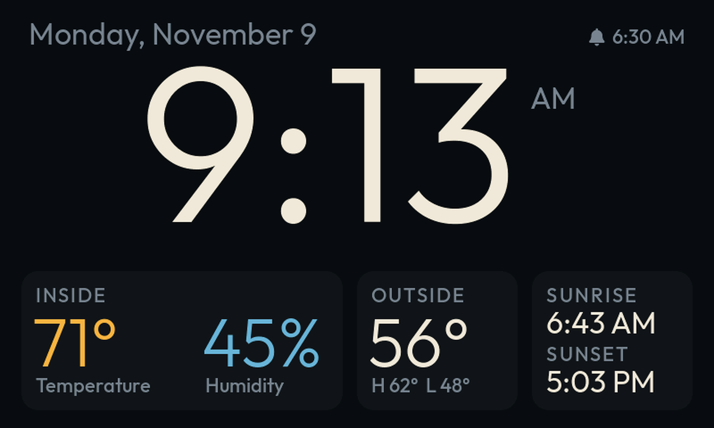
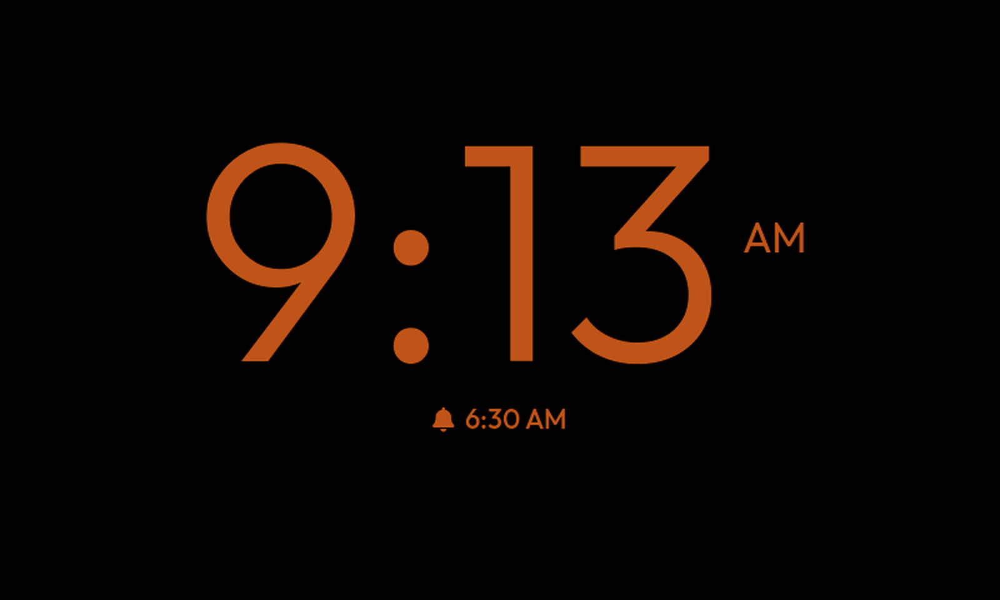
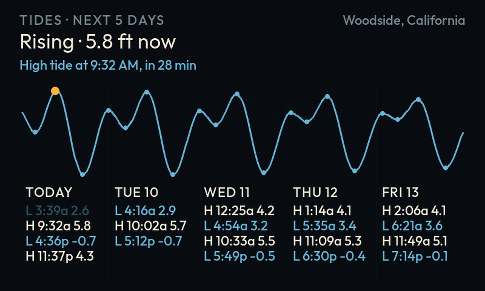
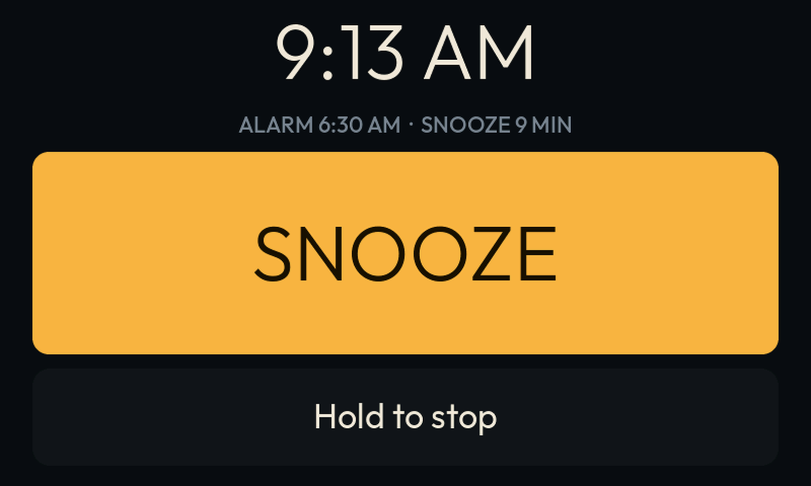
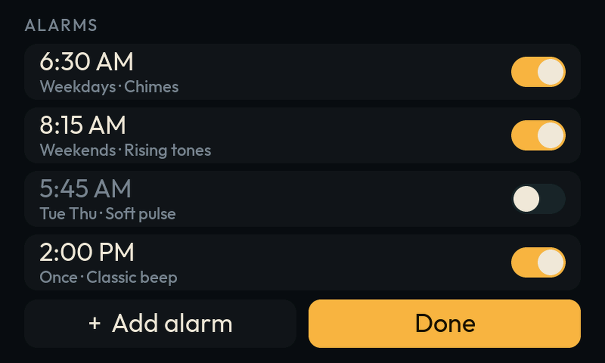
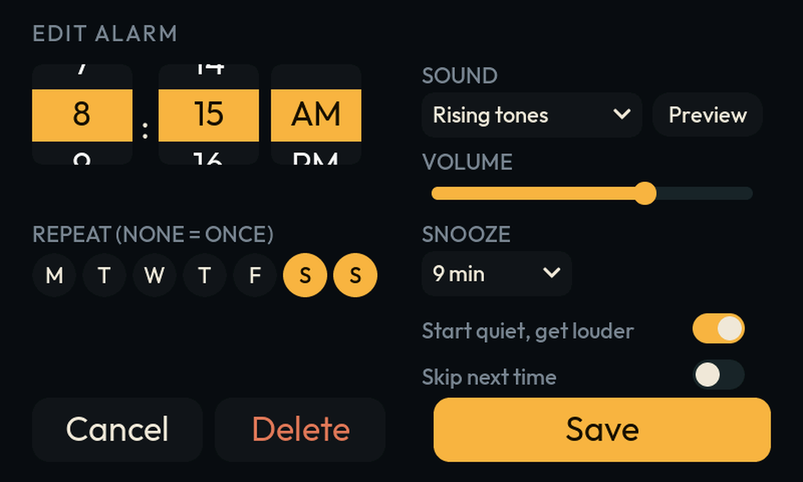
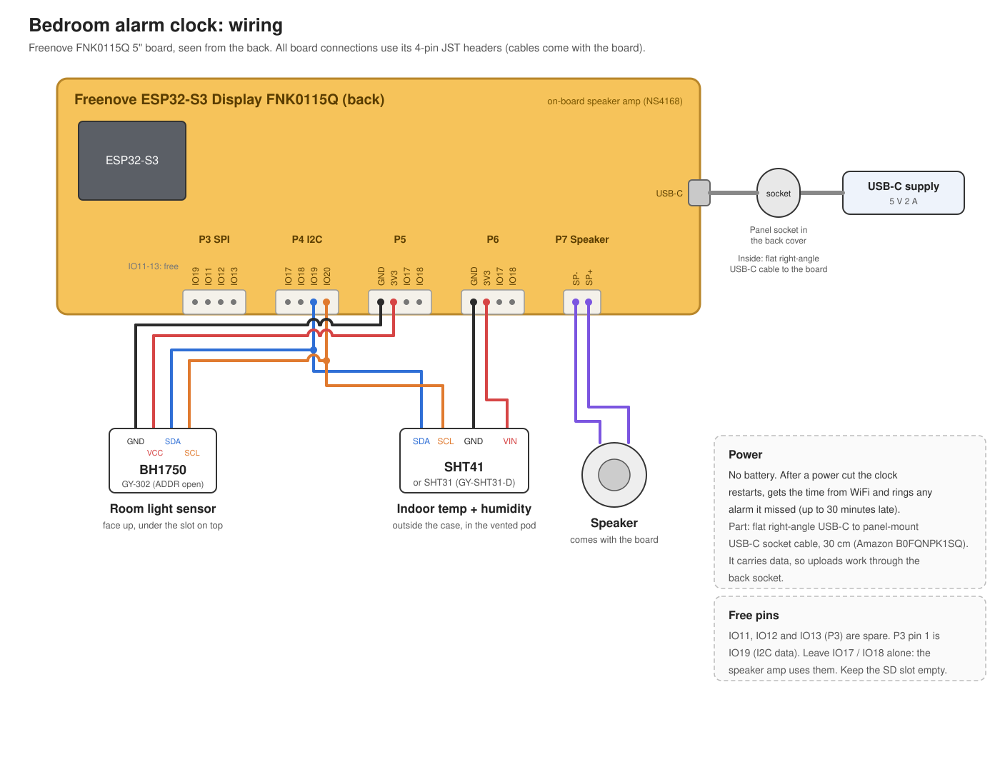
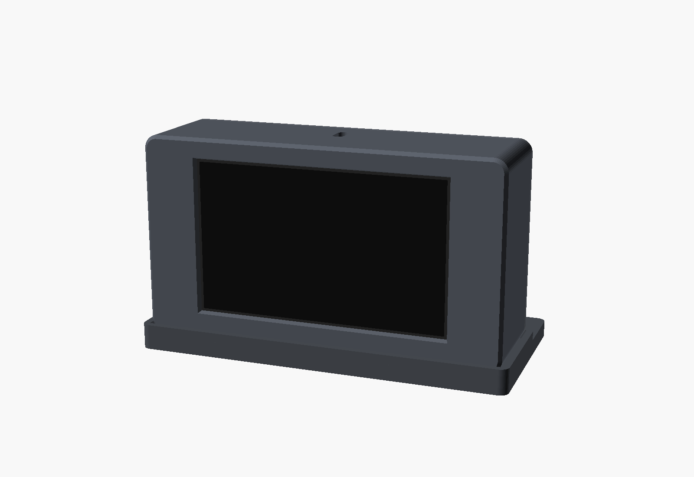
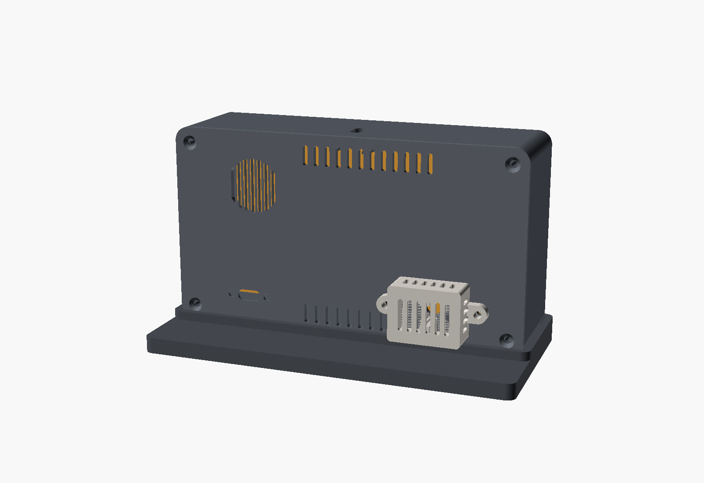
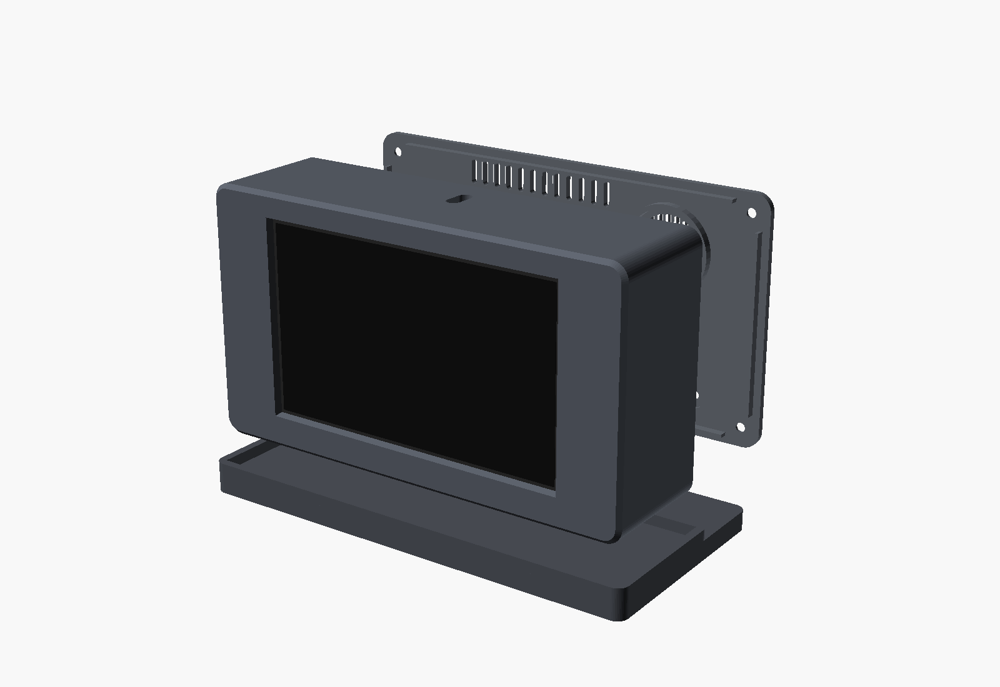

# Bedroom Alarm Clock

A bedside clock with a large touchscreen. It shows the time, indoor temperature and humidity, outside weather, and sunrise and sunset. Double-tap it to see the tides. At night it dims to a faint amber clock, and a tap brightens it so you can read it. It runs on an ESP32-S3 display board, needs no app or account, and sets its time over WiFi.

| Day | Night | Double-tap: tides |
|---|---|---|
|  |  |  |

| Alarm ringing | Alarms | Editing an alarm |
|---|---|---|
|  |  |  |

## Using it

- **Night mode** comes on when the room goes dark (with the optional light sensor) or, without it, from 10 PM to 7 AM: the screen goes almost dark and shows only the time in deep amber, with the next alarm in small type underneath. Tap once to bring the full screen back for 15 seconds at a gentle brightness. That first tap never presses anything by accident. With the light sensor, switching on a lamp brings the screen back by itself, and in the daytime the screen is brighter in a bright room and softer in a dim one.
- **Tides:** double-tap the screen. You get a 5-day tide curve, each day's highs and lows (time and height), whether the tide is rising or falling, and the time until the next one. Drag a finger along the curve to read the predicted height at any time in the five days (the top lines show the day, time and height while your finger is down). Tap to go back, or it closes by itself after 30 seconds. The default station is NOAA 9414131, Pillar Point Harbor (Half Moon Bay).
- **Setting alarms:** tap the bell in the top right corner. You get a list of alarms (up to 10) with on/off switches. Tap one to change it, or **+ Add alarm**. For each alarm you pick the time, the days it repeats (none means it rings once and then turns itself off), one of four built-in sounds (Chimes, Soft pulse, Classic beep, Rising tones) or your own song with a Preview button, volume, snooze length, "start quiet, get louder" (fades up over a minute), and "skip next time" (for a day off; it carries on after that). The list closes by itself after a minute of no touches, without saving. You can also set alarms from your phone (see below).
- **When an alarm rings** the screen lights up fully, even at night. Tap the big **SNOOZE** button. To turn it off, hold **Hold to stop** for about a second, so a sleepy swipe can't switch it off. While snoozed, the top corner reads "Snoozed, 7 min · Turn off"; tap it to cancel the alarm for today. An alarm that nobody answers stops after 30 minutes. After a snooze it comes back at full volume.
- **Sleep sounds:** tap the music note left of the alarm. Pick **Rain** or **Ocean** (the clock makes them itself, no sound files), the volume, and when to stop (15 min, 30 min, 1 hour, 2 hours or all night). The last two minutes fade out, and an alarm ends it. While one plays, the note shows the minutes left; at night it sits small under the alarm. The same controls are on the phone settings page. To hear them before flashing, `tools/render_sleep.cpp` writes the same sounds to WAV files.
- **Sunrise wake-up:** each alarm can start a screen sunrise 15, 20 or 30 minutes before it rings. The screen goes from black through deep red and orange to warm white while the backlight comes up from its night level to full, so the room is already lit when the alarm sounds. A tap turns it off (the alarm still rings). To try it, open an alarm and press **Preview** next to Sunrise: a sped-up one runs in about a minute, then holds for 10 seconds. The phone page's alarm editor has the same setting and button.
- **Your own alarm song:** `tools/make_alarm_song.py` turns an MP3, FLAC or WAV clip into the clock's format (it fades out the end) and writes it to `data/`. Send it to the clock with `pio run -e fnk0115q -t uploadfs` (or `-e ota` over WiFi). It then shows up as an extra sound in the alarm editor. Your song stays out of git.
- **CO2 (optional SCD41 sensor):** when the room gets stuffy (1,400 ppm and up) the clock shows "CO2 ... ppm · open a window" under the time, and clears it once the level drops below 1,200. The reading is on the settings page and the hardware check screen.
- **Outside weather and sunrise/sunset** (default: Half Moon Bay, CA; set your own on the setup page) come from [Open-Meteo](https://open-meteo.com/) (free, no account), every 10 minutes. The condition ("Rain", "Cloudy"...) uses the ECMWF model, which catches rain sooner than the default US model. In the US the clock also checks the two nearest [National Weather Service](https://www.weather.gov/) stations (found automatically from your location), and if one is reporting rain, snow or thunder right now, that's what it shows. Tides come from [NOAA CO-OPS](https://tidesandcurrents.noaa.gov/). Nothing else leaves your network.

## Status

| What | State |
|---|---|
| Clock, date, indoor temperature and humidity, WiFi setup, network time | Working |
| Night mode with tap-to-brighten, outside weather, sunrise/sunset, tides | Working |
| Alarms with snooze, sounds (including your own song), screen sunrise | Working |
| Sleep sounds (rain, ocean) | Working |
| Settings page at `http://alarmclock.local` | Working |
| CO2 reading with a "stuffy room" reminder (optional SCD41) | Working |
| Firmware updates over WiFi | Working |
| 3D-printed case | Printed in PETG and assembled |
| LED-strip sunrise | Not started |

All of this runs on the real board, in the printed case.

## Parts

When the parts arrive, follow the [first power-up checklist](docs/bring-up.md): it brings the clock up one piece at a time, using the built-in hardware check screen (hold a finger on the clock for 3 seconds).


| Part | Notes | Approx. |
|---|---|---|
| Freenove ESP32-S3 Display **FNK0115Q**: "5.0-Inch IPS C-Touch" | 800x480 IPS, capacitive touch, speaker amp built in, speaker included | $40 |
| SHT41 or SHT31 breakout (e.g. GY-SHT41-D, GY-SHT31-D) | Temperature/humidity. The clock uses whichever one it finds; they're about equally good. (An AM2302 on IO11 also works.) | $4-10 |
| BH1750 light sensor board (GY-302) | Optional. Night mode follows the room going dark, and brightness follows the room light. Without it, night mode uses fixed hours | $2 |
| SCD41 CO2 sensor board (e.g. Teyleten) | Optional. 3.3 V only. Shows a reminder when the room gets stuffy | $15-25 |
| Small piece of perfboard, two 2x4 male headers, female Dupont leads | The sensor hub: shares 3V3, GND, SDA and SCL with up to four sensors ([layout](docs/hub-perfboard.png)) | |
| M3 x 6 mm pan-head screws (2) | For the USB-C panel socket, if your cable doesn't come with screws (M2.5 is too small) | |
| Screws: 10x M2.5 x 8 mm flat-head (countersunk) machine screws, and 10 heat-set brass inserts, M2.5 "Long" (initeq M2.5-0.45 Long: 4.37 mm across, 5.56 mm long) | For the printed case: 4 hold the board, 4 the back cover, 2 the sensor pod | |
| Flat right-angle USB-C male to panel-mount USB-C female cable, 30 cm (JSADZKJ "Ultra-Thin USB 3.1 Type C to C Panel Mount Screw Cable", Amazon B0FQNPK1SQ) | From the board's USB-C port to a screw-on socket in the back cover. Carries data, so uploads still work | $10 |
| USB-C power supply (5 V, 2 A) | | |

### Power cuts

There's no battery. After a power cut the clock simply starts again, and nothing that matters is lost:

- Alarms and settings are saved in the board's flash, so they survive.
- The time comes back from the internet a few seconds after WiFi connects. Until then the clock shows "--:--" and "Getting the time..." (or "Connecting to WiFi..." while the router is still starting up).
- If an alarm came due while the power was off, it rings as soon as the time is back, as long as it's no more than 30 minutes late. A snooze that ran out during the cut rings too, a snooze still running carries on, and an alarm that was ringing when the power went rings again.

## Wiring



All connections use the board's 4-pin JST headers (the board comes with cables). The diagram shows the board from the back, the way you'll see it when you wire it into the case. Pins are for the 5" FNK0115Q.

| From | To | Notes |
|---|---|---|
| SHT41/SHT31 VIN / GND | P6 **3V3** / **GND** | |
| SHT41/SHT31 SDA / SCL | P4 **IO19** / **IO20** | Leave ADR unconnected if your board has it |
| *or* AM2302 out / + / − | P3 IO11 / P6 3V3 / P6 GND | Connect only one sensor |
| BH1750 VCC / GND | P5 **3V3** / **GND** | Optional light sensor. Leave ADDR unconnected |
| BH1750 SDA / SCL | spliced onto the SHT41's SDA / SCL wires | Same I2C bus as the SHT41 and touch chip, no conflicts |
| SCD41 VDD / GND / SDA / SCL | 3V3 / GND / IO19 / IO20 | Optional CO2 sensor, same bus. 3.3 V only |
| Speaker | P7 | The one included with the board |
| Power | USB-C supply → panel socket in the back cover → flat right-angle cable → board's USB-C | Uploads work through the back socket too |

With more than one sensor, the tidy way is the sensor hub: one lead from the board brings 3V3, GND, IO19 (SDA) and IO20 (SCL) to a small perfboard on the inside of the back cover, and each sensor plugs into it with female Dupont leads ([hub layout](docs/hub-perfboard.png)). The bus runs at 100 kHz so the longer wires don't upset the touch chip, which shares it.

Leave IO17 and IO18 unconnected: the built-in speaker amp uses them. The SD slot shares the SPI header (P3), so leave it empty. Sounds are stored in the board's flash instead.

Keep the sensor outside the case: the screen and the ESP32 warm up and would make it read a few degrees high. The case has a spot for it on the back, near the bottom where the air is coolest. If the reading is still off, set a correction on the settings page.

(The 4.3" FNK0115L works with the same code, but it has no speaker amp. Add a MAX98357A on IO0/IO18/IO17 if you use one.)

## Case

| Front | Back | Opened up |
|---|---|---|
|  |  |  |

The case is in [`case/clock_case.scad`](case/clock_case.scad) (OpenSCAD), and ready-to-print STLs are in [`case/stl/`](case/stl/). It is about 162 x 94 x 46 mm plus an 11 mm base (the clock sits 4 mm into it, 76 mm deep with its foot), and has five parts:

| Part | File | Print |
|---|---|---|
| Front shell (bezel and sides) | `shell.stl` | Face down, in PLA or PETG. No supports needed. Has a slot on top with rails inside for the light sensor |
| Back cover | `back.stl` | Flat side down. Has the speaker grille, vents, the USB-C power socket, the sensor mount, and a slide-in holder for the CO2 sensor behind its own vents |
| Sensor pod (for the SHT31 breakout, 12.6 x 10.7 mm) | `pod.stl` | Roof down, as exported, no supports: the ears sit on 45° ramps and the vents have pointed ends. An AM2302 in its own white case doesn't need it: fix its tab to one of the pod holes with an M2.5 screw and nut instead |
| Base | `base.stl` | As it lies, no supports. Stops a tap on the screen from tipping the clock back: it adds a foot behind the clock and a pocket in the floor the clock sits on (open on top, hidden by the clock) for about 170 g of steel: two strips of twelve 1/4 oz stick-on wheel weights, side by side. Stick rubber feet on its corners |
| Fit-test frame | `fit.stl` | Optional and quick. Print it first to check the screen window and screw holes against your board |
| Quick fit test | `fit_quick.stl` | Faster (about 1 1/2 hours): thinner front and walls with openings beside the window; same screw posts, board edges and window |

**Measure before printing.** The board dimensions in the file were measured on the prototype board with two fit tests. Hold the fit-test frame against your board, or measure with calipers, and adjust the values at the top of `clock_case.scad` if needed. The most important ones are the board's size and hole positions (137.2 x 83.8 mm, checked with the fit test on 21 Nov), `stack_h` (from the front of the glass to the front of the circuit board), the speaker's size (`speaker`, 40.3 x 28 mm measured), and for the USB-C socket its flange and screw spacing (`usb_flange`, `usb_screw_dx`: 25.2 x 8.2 mm from the listing, 16.9 mm measured) and how far the right-angle plug sticks out past the board's edge (`usb_room`: the plug sticks out 9 mm, room is 9.5 mm). Then export new STLs:

```
openscad -D 'part="shell"' -o case/stl/shell.stl case/clock_case.scad
```

(use `back`, `pod`, `base`, `fit` and `fitq` for the other parts).

For a FlashForge Creator Pro (Sailfish firmware, X3G files), [`case/printer/ffcp_petg.ini`](case/printer/ffcp_petg.ini) is a PrusaSlicer profile (right extruder, PETG 250 °C / 60 °C bed, 0.2 mm, 3 walls, 20 % infill, no supports). Slice with `prusa-slicer --export-gcode --load case/printer/ffcp_petg.ini --center 0,0 -o shell.gcode case/stl/shell.stl`, then convert with GPX: `gpx -m fcp shell.gcode shell.x3g`.

**Putting it together**

First press the 10 heat-set inserts in with a soldering iron at about 200 to 230 °C (a tip made for inserts helps): one in each of the four board posts in the shell, one in each of the four corner blocks at the back of the shell, and one in each of the pod's two ears (on the flat face that goes against the case). Let the insert heat for 2 to 3 seconds, press it straight down until it's flush, and hold it still for a moment while it cools. Every screw is an M2.5 x 8 mm flat head.

1. Lay the board face down in the shell, so the screen sits in the window. Fix it with four screws into the inserts in the posts. The flat heads sit on the board, not in a countersink; a small M2.5 washer under each makes them sit neater. Snug is enough: don't press on the glass.
2. Glue the speaker into the rectangular fence on the back cover, facing out.
3. Fit the USB-C socket's flange into the pocket on the inside of the back cover and screw it in from outside with two M3 x 6 mm pan-head screws (or the ones that came with the cable). Plug the right-angle end into the board's USB-C port and fold the spare flat cable behind the board.
4. If you have the light sensor: solder a straight 4-pin header to it with the pins pointing out of the underside (not the face), so female Dupont leads hang down behind the board, then slide it face up into the rails under the slot in the top of the case, from the back, until it stops. Two small fingers on the back cover keep it from sliding back out once the cover is on.
5. Solder thin wires (the spare cables that come with the board work well) into the SHT31's pin holes, with a female Dupont at the hub end; thin wires carry less of the case's warmth to the sensor. Feed them out through the hole near the bottom of the back cover. Slide the sensor board into the pod's two grooves from the open side, pin edge last (or screw the AM2302's tab on), then fix the pod to the outside of the back cover with two screws from inside the cover: their heads sink into the cover's inner face and they thread into the inserts in the pod's ears. No glue: with the pod screwed on, the cover closes its open side and the board is trapped between the cover and the pod's roof.
6. If you have the CO2 sensor (SCD41): solder a straight 4-pin header in from the sensor side so the pins point into the case (or solder four wires into the holes), and plug female Dupont leads on, then slide it into the holder on the inside of the back cover, sensor first and facing the cover, until it hits the stop and the two latch arms click over its pin end (spread the arm tops with a fingernail to take it out). It sits behind its own small vents, at the other end from the temperature pod. ([picture](docs/co2-holder.png))
7. Slide the sensor hub into its holder in the middle of the back cover, headers facing up, until it hits the stop and the two latch arms click over its end. ([picture](docs/hub-holder.png))
8. Plug everything in, then close the back with four screws into the corner inserts. The cover fits either way round, so check it: the USB-C socket and the sensor pod go at the **bottom**, the speaker grille near the top, and the two small fingers inside the cover sit just behind the light sensor under the top slot.

The clock stands upright in the base. The IPS screen reads fine at an angle, so it doesn't need a tilt. On its own the clock is light (about 250 g) and only 46 mm deep, so under 1 N at the top of the screen would tip it back, and a firm tap is 2 to 3 N. The base's foot and about 150 g of steel raise that to about 3 N at the very top of the screen and 5 N in the middle. Stick the wheel weights into the pocket in the base floor (the clock covers them), stick four rubber feet on its corners, and hold the clock in it with two small pieces of double-sided foam tape or Velcro.

## Building and flashing

1. Install [VS Code](https://code.visualstudio.com/) with the **PlatformIO** extension, or the `pio` command-line tool.
2. Open this folder, plug in the board over USB-C, and run **Upload** (or `pio run -t upload`).
3. If the upload doesn't start, hold **BOOT**, tap **RESET**, then let go of BOOT and try again.
4. Later updates can go over WiFi: `pio run -e ota -t upload` (add `--upload-port <the clock's IP>` if `alarmclock.local` doesn't resolve). **Before the first USB upload**, change `password` under `[ota]` in `platformio.ini`: the clock only accepts WiFi updates with that password.

## First-time setup

1. When the clock first powers on, it shows *"To set up, join the WiFi network AlarmClock-Setup"*.
2. On your phone, join **AlarmClock-Setup**. A setup page opens (if it doesn't, browse to `192.168.4.1`).
3. Pick your home WiFi, then choose your time zone, 12/24-hour time, °F/°C, your town, ZIP or "lat, lon" (for weather; coordinates are best in the hills, where a ZIP lands in the valley), a NOAA tide station ID (optional; find one at [tidesandcurrents.noaa.gov](https://tidesandcurrents.noaa.gov/)), and weather stations for "rain now" (optional: leave it blank for the nearest two, or type IDs like `KHAF,KSFO`). Save. Half Moon Bay, Pillar Point Harbor tides and Pacific time are filled in to start with.
4. The clock connects, sets its time from the internet, and keeps it updated after that, including daylight saving.

If your WiFi changes, the setup network comes back by itself whenever the clock can't connect.

## Settings from your phone or computer

Once the clock is on your WiFi, open **http://alarmclock.local** in any browser on the same
network (or the address shown on the hardware check screen). From there you can add, edit,
switch off and delete alarms (with a Preview button that plays the sound on the clock), and
change brightness, night hours, 12/24-hour time, °F/°C, time zone, the inside temperature
correction, location, weather stations and tide station. It also shows the readings (inside,
outside, room light, CO2) and runs the sleep sounds. Changes take effect on the clock straight
away.

On an iPhone, open it in Safari and tap **Share → Add to Home Screen**: it gets a clock icon
and opens full-screen like an app. There's no password, so anyone on your WiFi can use it.

The page is `web/index.html`. It's packed into the firmware on every build; opened straight
from disk, it shows sample data, so you can preview changes without a clock.

## Code layout

| File | Purpose |
|---|---|
| `src/board.h` | Pin map for the FNK0115Q |
| `src/display.cpp` | Screen, touch, backlight dimming, LVGL setup |
| `src/sensor.cpp` | SHT4x and AM2302 drivers (also keeps a 24-hour history for the future web page) |
| `src/weather.cpp` | Background fetch of Open-Meteo weather/sunrise and NOAA tides |
| `src/nightmode.cpp` | Night dimming (by room light or schedule), tap-to-brighten, fades |
| `src/light.cpp` | Optional BH1750 room light sensor |
| `src/diag.cpp`, `src/ui_diag.cpp` | Hardware check: serial report and the on-screen check (hold 3 s) |
| `src/alarm.cpp` | Alarm list (saved in flash), scheduling, snooze and stop, catching up after a power cut |
| `src/audio.cpp` | Alarm sounds, made on the fly and played through the I2S amp |
| `src/sleep.cpp`, `src/sleep_synth.h`, `src/ui_sleep.cpp` | Sleep sounds: rain and ocean made from noise, the timer, and their screen |
| `src/sunrise.cpp`, `src/ui_sunrise.cpp` | Screen sunrise before an alarm, its preview, and the glowing screen |
| `src/ui_alarms.cpp` | Ringing screen, alarm list and alarm editor |
| `src/net.cpp` | WiFi setup portal, network time, `alarmclock.local` |
| `src/web.cpp`, `web/` | Settings page at `alarmclock.local` and its JSON interface; `tools/embed_web.py` packs `web/` into the firmware at build time |
| `src/settings.cpp` | Saved settings (time zone, units, night hours, location, weather and tide stations) |
| `src/ui.cpp` | Clock screen and tide screen |
| `src/fonts/` | Generated from the Outfit typeface (SIL Open Font License); rebuild with `tools/gen_fonts.sh` |

Built with Arduino-ESP32 3.x (via [pioarduino](https://github.com/pioarduino/platform-espressif32)), LVGL 9.5, Arduino_GFX, TAMC_GT911, WiFiManager and ArduinoJson.

## License

MIT for everything here: firmware, web page, case files and docs (see [LICENSE](LICENSE)). The Outfit fonts in `src/fonts/` are under the SIL Open Font License, and the libraries keep their own licenses.
